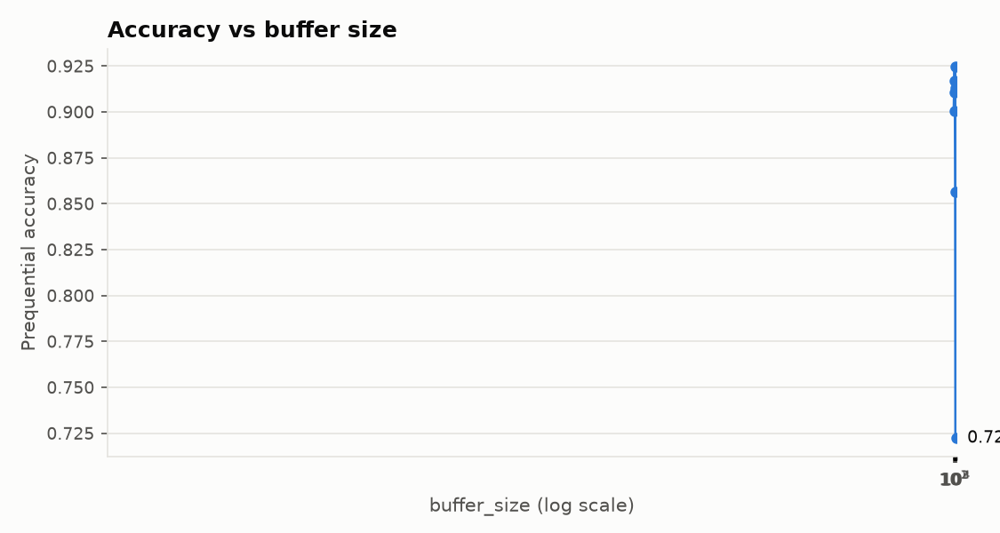
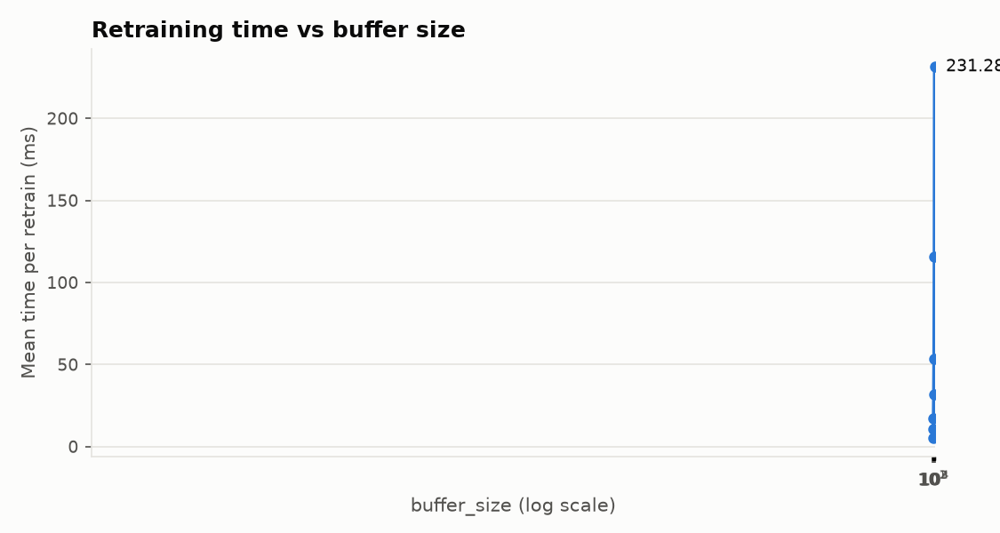
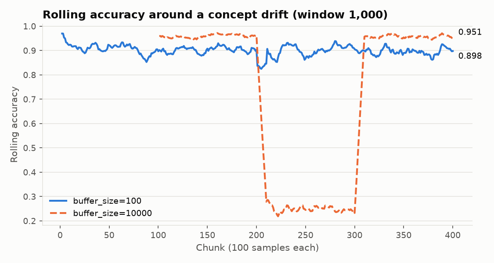

# NumCompute-Stream

**NumCompute-Stream** is a decision-tree-based streaming machine learning framework written with **plain Python, NumPy and matplotlib only** (no scikit-learn, pandas, SciPy or deep-learning libraries). It extends the Assignment 2.1 NumCompute toolkit so that every component learns from data that arrives in chunks:

- **Streaming learning.** Models, preprocessing, metrics and statistics all update incrementally through `.partial_fit()` or `.update()`.
- **Buffered decision tree.** A single decision tree built from scratch. Each `.partial_fit()` call adds the chunk to a buffer; when the buffer holds `buffer_size` samples the tree is retrained on it and the buffer is cleared. Between retrains `.predict()` uses the most recent tree.
- **Built-in visualisation.** `visualise.py` plots metrics over time, compares two models and shows predictions against ground truth.

Assignment 2.2 (individual work). The `main` branch holds the original group code from Assignment 2.1; the `Individual` branch holds the Assignment 2.2 code.

## Contents

- [Requirements](#requirements)
- [Installation](#installation)
- [Check that everything works](#check-that-everything-works)
- [Quick start](#quick-start)
- [Project structure](#project-structure)
- [API overview](#api-overview)
- [Conventions](#conventions)
- [Running the demo](#running-the-demo)
- [Running the tests](#running-the-tests)
- [Running the benchmarks](#running-the-benchmarks)
- [Benchmark results](#benchmark-results)
- [What changed since Assignment 2.1](#what-changed-since-assignment-21)
- [Troubleshooting](#troubleshooting)

## Requirements

| Requirement | Version | Needed for |
|---|---|---|
| Python | 3.9 or newer | everything |
| NumPy | 1.22 or newer (developed with NumPy 2.x) | everything |
| matplotlib | 3.5 or newer | `visualise.py`, the demo plots |
| pytest | 7 or newer | running the tests (optional) |
| Jupyter | any recent version | the demo notebook (optional) |

Besides NumPy and matplotlib only the Python standard library is used (`csv`, `logging`, `time`, `os`, `sys`, `argparse`, `inspect`, `gc`, `platform`; `heapq` and `bisect` appear only in the benchmark baselines).

## Installation

`pyproject.toml` is at the **repository root**, next to the `numcompute_stream/` folder, so every command below is run from the repository root. Each option was checked against a clean checkout.

### Option A: no installation (quickest)

```bash
git clone -b Individual <repository-url>
cd <repository-folder>
python -m pip install numpy matplotlib        # skip if you already have them
python demo/iris_demo.py                      # the demo adds the repo root to sys.path itself
```

From the repository root, `import numcompute_stream` works directly because the current folder is on Python's path. From anywhere else set `PYTHONPATH=/path/to/<repository-folder>`.

### Option B: editable install in a virtual environment

```bash
git clone -b Individual <repository-url>
cd <repository-folder>
python -m venv .venv
source .venv/bin/activate                     # Windows: .venv\Scripts\activate
python -m pip install -e ".[dev]"             # numpy, matplotlib, plus pytest and jupyter
python -c "import numcompute_stream as ncs; print(ncs.__version__)"
```

### Option C: regular install

```bash
python -m pip install .                       # from the repository root
```

The repository is private, so installing straight from a GitHub URL needs your own GitHub login; a local checkout (options A to C) needs no credentials.

## Check that everything works

Three commands, all run from the repository root:

```bash
python demo/iris_demo.py        # end-to-end run on Iris, ends with "ALL CHECKS PASSED"
python -m pytest                # the unit tests
python benchmark/stream_benchmarks.py --quick    # streaming benchmarks, a few seconds
```

## Quick start

```python
import numpy as np
from numcompute_stream import io, metrics, visualise
from numcompute_stream.pipeline import Pipeline
from numcompute_stream.preprocessing import Imputer, StandardScaler
from numcompute_stream.stream import StreamTrainer, iter_chunks
from numcompute_stream.tree import DecisionTreeClassifier

# 1. load a CSV (numeric columns as floats, the label column as text)
X, text, names = io.load_mixed_csv("demo/data/iris.csv", numeric_cols=(0, 1, 2, 3), header=True)
y = text[:, 0]

# 2. a chained pipeline whose every step supports partial_fit
pipe = Pipeline([
    ("impute", Imputer(strategy="mean")),
    ("scale", StandardScaler()),
    ("model", DecisionTreeClassifier(max_depth=4, buffer_size=30)),
])

# 3. the streaming loop by hand ...
for X_chunk, y_chunk in iter_chunks(X, y, chunk_size=10, shuffle=True, seed=0):
    pipe.partial_fit(X_chunk, y_chunk)        # buffers; retrains every 30 samples
print(pipe.predict(X[:5]))

# ... or with StreamTrainer, which scores each chunk before training on it and keeps the log
trainer = StreamTrainer(pipe.reset(), metrics={"macro_f1": metrics.StreamingF1(average="macro")},
                        window=50, verbose=True)
trainer.run(iter_chunks(X, y, chunk_size=10, shuffle=True, seed=0))
print(trainer.summary())

# 4. visualise
visualise.plot_metric_over_time(trainer.get_metric("cumulative_accuracy"),
                                title="Accuracy over time", ylabel="Cumulative accuracy",
                                save_path="accuracy.png", show=False)
```

The tree on its own, exactly as in the specification:

```python
tree = DecisionTreeClassifier(max_depth=5, buffer_size=500)
for X_chunk, y_chunk in stream:
    tree.partial_fit(X_chunk, y_chunk)
```

## Project structure

```text
<repository root>/
├── numcompute_stream/
│   ├── __init__.py
│   ├── stream.py          StreamTrainer (fit_chunk, score_chunk, run, logging), iter_chunks, memory_footprint
│   ├── tree.py            DecisionTreeClassifier: fit, partial_fit (buffered retraining), predict
│   ├── preprocessing.py   StandardScaler, MinMaxScaler, Imputer, OneHotEncoder, ColumnTransformer (all partial_fit)
│   ├── stats.py           batch statistics + RunningStats, StreamingQuantile, StreamingHistogram, update_stats
│   ├── metrics.py         batch metrics + Streaming{Accuracy, Precision, Recall, F1, ConfusionMatrix, MSE, AUC}
│   ├── pipeline.py        Transformer/Estimator API, Pipeline (partial_fit), FeatureUnion
│   ├── visualise.py       plot_metric_over_time, compare_models, plot_predictions_vs_ground_truth
│   ├── io.py              CSV reader: whole file, chunked (iter_csv), mixed numeric/text
│   ├── utils.py           distances, activations, logsumexp, batching, NotFittedError
│   ├── sort_search.py     stable sort, top-k, quickselect, binary search        (from 2.1)
│   ├── rank.py            ranking with ties, percentiles                        (from 2.1)
│   ├── optim.py           finite-difference gradient and Jacobian               (from 2.1)
│   └── benchmarking.py    timing harness with a correctness gate
├── tests/                 unit tests (pytest)
├── demo/
│   ├── stream_demo.ipynb  the demo notebook (outputs included)
│   ├── iris_demo.py       the same flow as a terminal script with self-checks
│   └── data/iris.csv
├── benchmark/
│   ├── stream_benchmarks.py   (a) loop vs vectorised under streaming, (b) buffer_size
│   ├── run_benchmarks.py      loop vs vectorised for the batch functions
│   ├── baselines.py           pure-Python loop versions
│   └── results/               result tables (CSV and Markdown) and plots
├── README.md
└── pyproject.toml
```

## API overview

Every public function and class documents its parameters, input and output shapes, exceptions and time/space complexity in its docstring, e.g. `help(numcompute_stream.tree.DecisionTreeClassifier.partial_fit)`.

### `stream.py`

| API | What it does |
|---|---|
| `StreamTrainer(model, metrics=None, window=200, name=None, verbose=False)` | Manages a model or pipeline over a stream and keeps the log. |
| `.fit_chunk(X, y)` | Trains on one chunk (`partial_fit`) and appends a log record. |
| `.score_chunk(X, y)` | Predicts the chunk with the current model and updates the metrics. |
| `.run(stream)` | Test-then-train over every `(X_chunk, y_chunk)` of a stream. |
| `.history`, `.get_metric(key)`, `.summary()`, `.format_log()`, `.save_log(path)` | The log: per chunk `chunk_accuracy`, `cumulative_accuracy`, `rolling_accuracy`, `error`, `fit_seconds`, `predict_seconds`, `retrained`, `n_retrains`, `buffer_count`, `memory_bytes`, plus any extra metric. |
| `iter_chunks(X, y, chunk_size, shuffle=False, seed=None)` | Cuts a dataset into chunks to simulate a stream. |
| `memory_footprint(obj)` | Bytes held in the NumPy arrays of a model (learned state plus buffer). |

### `tree.py`

`DecisionTreeClassifier(max_depth=5, min_samples_split=2, max_features=None, buffer_size=500, criterion="gini", random_state=None)`

| Method | What it does |
|---|---|
| `.fit(X, y)` | Trains the tree from scratch on the given data. |
| `.partial_fit(X_chunk, y_chunk, classes=None)` | Appends the chunk to the buffer; at `buffer_size` samples retrains on the buffer and clears it. Alias `update`. |
| `.predict(X)`, `.predict_proba(X)`, `.apply(X)`, `.score(X, y)` | Use the most recently trained tree. |
| `.flush()` | Retrains now on a partly filled buffer (end of a stream). |
| `.reset()`, `.export_text(feature_names)`, `.get_depth()`, `.get_n_leaves()` | Housekeeping and inspection. |

`DecisionTree` is a short alias of the same class, so `DecisionTree(max_depth=5, buffer_size=500)` works as written in the brief. `criterion` is `"gini"` or `"entropy"`. `max_features` is `None`, an int, a fraction in (0, 1], `"sqrt"` or `"log2"`. Attributes after training: `classes_`, `feature_`, `threshold_`, `left_`, `right_`, `value_`, `n_retrains_`, `n_samples_seen_`, `buffer_count_`, `last_fit_seconds_`.

### `preprocessing.py`

`StandardScaler`, `MinMaxScaler`, `Imputer`, `OneHotEncoder` and `ColumnTransformer` all have `fit`, `partial_fit(X, y=None)` (alias `update`), `transform`, `fit_transform` and `reset`. The scaler keeps a running count, mean and sum of squared deviations per feature and merges each chunk with the Welford/Chan update; the imputer updates its fill values chunk by chunk; the encoder appends new categories as they appear (`freeze()` stops that).

### `stats.py`

| API | What it does |
|---|---|
| `RunningStats()` | Streaming count, mean, variance, std, min, max. `partial_fit` / `update` / `update_stats`. |
| `StreamingQuantile(capacity=4096, window=None, seed=0)` | Quantiles from a reservoir sample (whole stream) or exactly over a sliding window. |
| `StreamingHistogram(bins, range, window=None)` | Fixed-edge histogram, optionally over a sliding window; counts values outside the range separately. |
| `StreamStats(...)`, `.update_stats(X_chunk)`, `.result()` | All of the above behind one call. |
| `update_stats(X_chunk, state=None)` | The same as a function: `state = update_stats(chunk, state)`. |

The batch functions from 2.1 (`mean`, `var`, `std`, `quantile`, `median`, `mode`, `histogram`, `describe`, ...) are unchanged.

### `metrics.py`

Streaming classes, each with `update(y_true_chunk, y_pred_chunk)`, `result()` and `reset()`:

`StreamingAccuracy`, `StreamingPrecision`, `StreamingRecall`, `StreamingF1` (`average` = `binary`, `macro`, `micro`, `weighted` or `None`), `StreamingConfusionMatrix`, `StreamingMSE`, `StreamingAUC`.

All accumulate over the whole stream by default; `window=N` makes any of them a rolling-window metric over the last N samples. The confusion matrix grows when new classes appear. `StreamingAUC` keeps two score histograms (bounded memory) instead of every score. The batch functions (`accuracy`, `precision`, `recall`, `f1`, `confusion_matrix`, `mse`, `roc_curve`, `auc`, `roc_auc_score`) are unchanged.

### `pipeline.py`

`Pipeline(steps)` with `fit`, `partial_fit(X, y=None)` (alias `update`), `transform`, `fit_transform`, `predict`, `reset`; `FeatureUnion` with `fit`, `partial_fit`, `transform`. In `partial_fit` each transformer first learns from the chunk, then transforms it, and the transformed chunk goes to the next step; `y` goes to the final model.

### `visualise.py`

| Function | Plot |
|---|---|
| `plot_metric_over_time(metric_values, title, ylabel, xlabel="Chunk", x=None, ...)` | One metric across chunks. |
| `compare_models(metric1, metric2, labels, title=..., ylabel=..., ...)` | Two models on the same metric. |
| `plot_predictions_vs_ground_truth(y_true, y_pred, title=None, ...)` | Predictions against the true labels of a chunk. |

Every function also takes `save_path=` (write to a file), `show=` (display inline or in a window) and `ax=` (draw into an existing axes), and returns `(fig, ax)`.

### Carried over from Assignment 2.1

`io` (`load_csv`, `iter_csv`, `load_mixed_csv`), `sort_search`, `rank`, `optim`, `utils` and `benchmarking` keep their 2.1 API. `io.iter_csv` reads a file chunk by chunk. The functions in `sort_search`, `rank`, `optim` and `utils` keep no state between calls, so in a stream they are simply called on each chunk.

## Conventions

- **Shapes.** `X` is `(n_samples, n_features)`, `y` is `(n_samples,)`. Statistics are per feature (axis 0). The number of features is fixed by the first chunk; a later chunk with a different number raises `ValueError`.
- **Chunks.** A chunk may have zero rows; it is accepted and changes nothing. A chunk that fails validation is rejected before any state changes.
- **Not fitted yet.** `predict`/`transform` before any training raises `NotFittedError` (a `RuntimeError`). A buffered tree raises it until its first retrain; `StreamTrainer` records such chunks as "not scored" with NaN metrics rather than failing or counting them as zero.
- **NaN.** NaN means "missing". Preprocessing and statistics ignore it when learning; the tree sends a missing feature to the right child in training and prediction, and can split on "missing or not"; metrics reject NaN labels.
- **Infinity.** Rejected with `ValueError` by `preprocessing`, the `stats` functions and classes, `rank.percentile`, `metrics.mse`, `utils.pairwise_distances`, the tree's `X` and `StreamingAUC` scores, because a mean, variance, distance or threshold with an infinite input is not meaningful. It is accepted where it has a defined order or limit: `sort_search`, `rank.rank`, `utils.topk_along_axis` and the activation functions in `utils`.
- **Ties.** Equal split gains go to the lowest feature index, then the lowest threshold. A leaf with tied class counts predicts the class that comes first in `classes_`. Tied scores count half in the AUC.
- **Zero variance.** A constant feature is scaled to 0 (never a division by zero) and offers the tree no split; a node whose features are all constant becomes a leaf.
- **Vectorisation.** Core computations have no Python loop over samples. The remaining loops are over tree nodes while building, tree levels while predicting, columns of categorical data, pipeline steps, and chunks.
- **Reproducibility.** Anything random takes a seed (`iter_chunks`, `max_features`, the quantile reservoir, the benchmarks).

## Running the demo

**Terminal** (prints the log, saves plots to `demo/outputs/`, ends with self-checks):

```bash
python demo/iris_demo.py
python demo/iris_demo.py --show                         # also open the plot windows
python demo/iris_demo.py --chunk-size 15 --buffer-size 45 --seed 3
```

**Notebook:**

```bash
python -m pip install jupyter      # if needed
jupyter notebook demo/stream_demo.ipynb
```

then `Kernel > Restart & Run All`. The notebook imports the package from your local checkout: it needs no internet access, no `git clone` and no GitHub token. It loads `demo/data/iris.csv` with `io.py`, splits it into chunks, trains the pipeline with `.partial_fit()`, logs the metrics and plots them with `visualise.py`. Its saved outputs include the benchmark tables.

## Running the tests

```bash
python -m pytest                  # all tests
python -m pytest tests/test_tree.py -v
python -m pytest --doctest-modules numcompute_stream    # the docstring examples
```

395 tests. The streaming tests cover: chunked results equal to batch results for every chunk size (including chunks of one sample), empty chunks, NaN, zero-variance chunks, ties, new classes arriving mid-stream, a changed feature count, rolling windows, the buffer filling, clearing and retraining, prediction between retrains, and invalid inputs. `tests/test_regressions.py` holds the cases from the Assignment 2.1 feedback (see below) and a clean-import smoke check.

## Running the benchmarks

```bash
python benchmark/stream_benchmarks.py              # streaming: loop vs vectorised, and buffer_size
python benchmark/stream_benchmarks.py --quick      # small sizes, a few seconds
python benchmark/stream_benchmarks.py --part b     # only the buffer_size study
python benchmark/run_benchmarks.py                 # batch functions carried over from 2.1
```

Options: `--quick`, `--repeat N`, `--seed S`, `--out DIR`, and `--part a|b|both`, `--no-plots` for the streaming script. Every loop/vectorised pair is first checked to give the same result on the same seeded data and only then timed (median of the repeats). Results are written to `benchmark/results/` as CSV, Markdown and PNG.

## Benchmark results

Environment for the numbers below: Python 3.13.18, NumPy 2.5.3, Linux x86_64, 2 CPU cores, seed 0. Timings vary between machines; the accuracies are reproducible with the seed.

### (a) Loop vs vectorised under streaming

| case | n | baseline | loop (ms) | vectorised (ms) | speed-up | results match |
|---|---:|---|---:|---:|---:|:---:|
| tree: best split of one node (d=8) | 200 | loop over features x thresholds x rows | 10.055 | 0.396 | 25.4x | yes |
| tree: best split of one node (d=8) | 1,000 | loop over features x thresholds x rows | 55.039 | 1.325 | 41.5x | yes |
| tree: best split of one node (d=8) | 4,000 | loop over features x thresholds x rows | 266.248 | 4.592 | 58.0x | yes |
| tree: predict (depth 6) | 2,000 | one root-to-leaf walk per row | 0.394 | 0.188 | 2.1x | yes |
| tree: predict (depth 6) | 20,000 | one root-to-leaf walk per row | 3.780 | 1.123 | 3.4x | yes |
| tree: predict (depth 6) | 200,000 | one root-to-leaf walk per row | 57.380 | 22.145 | 2.6x | yes |
| tree: buffered stream (buffer 500, depth 4) | 1,000 | loop tree, per-row predict | 113.258 | 6.178 | 18.3x | yes |
| tree: buffered stream (buffer 500, depth 4) | 4,000 | loop tree, per-row predict | 438.776 | 22.032 | 19.9x | yes |
| metrics: confusion matrix, chunks of 100 | 1,000,000 | one increment per sample | 39.042 | 190.566 | 0.2x | yes |
| stats: running mean/variance, chunks of 100 | 1,000,000 | Welford, one value at a time | 48.047 | 303.379 | 0.2x | yes |
| stats: histogram (20 bins), chunks of 100 | 1,000,000 | one bin lookup per value | 88.795 | 136.912 | 0.6x | yes |
| metrics: confusion matrix, chunks of 10,000 | 1,000,000 | one increment per sample | 38.377 | 16.305 | 2.4x | yes |
| stats: running mean/variance, chunks of 10,000 | 1,000,000 | Welford, one value at a time | 50.000 | 8.518 | 5.9x | yes |
| stats: histogram (20 bins), chunks of 10,000 | 1,000,000 | one bin lookup per value | 79.905 | 33.913 | 2.4x | yes |

Reading the table:

- The tree's split search is where vectorisation matters most: one sort and one cumulative sum replace the loop over features, thresholds and rows, and the gap widens with the node size.
- Prediction gains less, because the loop baseline already does very little work per row.
- For the per-chunk updates the chunk size decides. A NumPy call has a fixed overhead and the streaming classes also validate every chunk, so with chunks of 100 values a plain loop is faster; with chunks of 10,000 the vectorised update wins. Small chunks are a real cost of streaming, not a flaw in the measurement.

### (b) Buffer size

- stream: 40,000 samples, 10 features, 4 classes, chunks of 100, labelling rule changes at the half-way point, 5% label noise
- tree: max_depth=6, gini; accuracy is prequential (test-then-train)
- samples to recover: samples after the drift until the rolling accuracy (last 1,000 samples) is back at 0.8 or more, checked from 1,000 samples after the drift (when the window holds only post-drift data)

| buffer_size | retrains | accuracy | before drift | after drift | samples to recover | mean retrain (ms) | total retrain (ms) | peak memory (KiB) |
|---:|---:|---:|---:|---:|---:|---:|---:|---:|
| 100 | 400 | 0.900 | 0.905 | 0.896 | 1,000 | 1.33 | 533.0 | 2.9 |
| 250 | 133 | 0.911 | 0.917 | 0.904 | 1,200 | 3.75 | 498.2 | 23.5 |
| 500 | 80 | 0.917 | 0.926 | 0.908 | 1,300 | 6.20 | 496.2 | 40.3 |
| 1,000 | 40 | 0.924 | 0.941 | 0.909 | 1,700 | 12.88 | 515.2 | 83.6 |
| 2,000 | 20 | 0.913 | 0.950 | 0.880 | 2,700 | 20.36 | 407.3 | 170.3 |
| 5,000 | 8 | 0.856 | 0.957 | 0.781 | 5,700 | 52.07 | 416.5 | 427.2 |
| 10,000 | 4 | 0.722 | 0.960 | 0.604 | 10,700 | 106.93 | 427.7 | 856.6 |





Reading the table:

- **Stable data favours a large buffer.** Before the drift, accuracy rises steadily with `buffer_size` because each tree is trained on more samples.
- **Changing data favours a small buffer.** After the drift the order reverses: a small buffer replaces the outdated tree within a few hundred samples, while the largest buffer keeps predicting with it for thousands.
- **Retraining time per retrain grows roughly in proportion to the buffer**, but there are proportionally fewer retrains, so the total training time stays in the same range for every buffer size. What changes is how the cost arrives: many short pauses or a few long ones.
- **Memory grows in proportion to the buffer**, which is the only part of the model that scales with the data.
- On this stream the best overall accuracy is at a middle value (`buffer_size=1000`).

The full tables, including every size, are in `benchmark/results/`.

## What changed since Assignment 2.1

New for 2.2: `tree.py`, `stream.py`, `visualise.py`; streaming classes in `stats.py` and `metrics.py`; `Pipeline.partial_fit` feeding a model; `FeatureUnion.partial_fit`; the package renamed to `numcompute_stream`.

Fixes for the Assignment 2.1 feedback, each with a regression test in `tests/test_regressions.py`:

| Feedback | Fix |
|---|---|
| `pairwise_distances([[1e9]], [[1e9+1], [-1e9]])` returned 0 instead of 1 | Pairs whose squared distance is tiny compared with `|x|^2 + |y|^2` (where the expanded formula cancels) are recomputed directly as `sum((x - y)^2)`. Centring alone could not help when the reference points are far apart. |
| `OneHotEncoder` fitted on integers 1, 2 gave zero rows for floats 1.0, 2.0 | Categories are compared by value in a canonical text form, so whole-number floats and integers are the same category. Text codes such as `"1"` and `"1.0"` stay distinct, and this is documented. |
| README install commands failed from the repository root | `pyproject.toml` now sits at the repository root next to the package; the three install options above were run against a clean checkout. |
| The notebook needed GitHub credentials | The notebook and the demo script use the local checkout. No clone, no token. |
| No clean-install/import smoke check | `test_clean_import_smoke_check` imports every module in a fresh interpreter started outside the repository. |
| Benchmark results file was empty | The CSV writer wrote only the header. Fixed, tested, and the populated result files are committed together with the notebook's benchmark output. |
| Blanket claims about infinity and about benchmarking every function | The Conventions section lists exactly where infinity is rejected and where it is accepted. The benchmarks cover the cases listed in `benchmark/results/`, not every function. |

## Troubleshooting

| Problem | What to do |
|---|---|
| `ModuleNotFoundError: numcompute_stream` | Run from the repository root, or install with `python -m pip install -e .`, or set `PYTHONPATH` to the repository root. |
| `NotFittedError` from `predict` | The tree's first buffer is not full yet. Feed more chunks, lower `buffer_size`, or call `tree.flush()`. |
| Accuracy is `n/a` for the first chunks | Expected: no tree exists until `buffer_size` samples have arrived. |
| The first chunks contain one class | The file is sorted by label. Use `iter_chunks(..., shuffle=True, seed=...)`. |
| No plot window appears | Pass `--show` to the demo, or `show=True` to the plotting function. On a machine without a display, use `save_path=` instead. |
| A speed-up below 1x in the benchmarks | Expected for very small inputs or chunks (fixed NumPy call overhead). See the notes under the result tables. |
